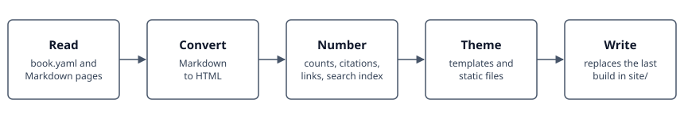

# bookspine

bookspine turns a directory of Markdown chapters into a textbook-style static site,
with numbered parts, chapters, sections, equations, figures, tables and boxed
environments, citations, client-side search, and light and dark colour schemes. The
theme comes with the package, so a book holds only its content and one configuration
file. A second layout leaves out the numbers, for a site that readers look things up in.



| Step | What it does |
|---|---|
| Read | Reads `book.yaml` and the Markdown files it lists, in reading order. |
| Convert | Turns each page's Markdown into HTML. |
| Number | Numbers sections, figures, captioned tables, boxes and equations, resolves citations and links, and collects the search index. |
| Theme | Puts each page into its template and gathers the static files. |
| Write | Replaces what the last build wrote in `site/`. |

The build stops on a broken internal link or anchor, a link that starts at the site's
root, a missing figure, a citation without a reference entry, an `\eqref` to a label no
numbered equation carries, an equation label used twice, or a [mark](#equations) that
stands where an equation cannot break on a narrow screen. A failed build leaves `site/`
as it was.

## Install

```bash
pip install bookspine
```

bookspine needs Python 3.11 or later and runs on Linux, macOS and Windows. pip installs a
prebuilt wheel on x86-64 and ARM Linux with glibc 2.17 or later, on macOS with Apple silicon
and on 64-bit Windows. Anywhere else it compiles the package, which needs a C compiler and,
if Rust is not installed, downloads a copy of about 500 MB into the user cache.

## Usage

A book is a project directory:

```text
my-book/
├── book.yaml             # title, author, parts and chapters
├── book/
│   ├── index.md          # the title page
│   ├── help.md           # an optional help page
│   └── methods/          # a part
│       ├── index.md      # the part's opener
│       ├── basics.md     # a chapter on one page
│       └── figures/
└── theme/                # optional overrides
```

Build it and preview the result:

```bash
bookspine build my-book
python -m http.server --directory my-book/site 8000
```

Then open <http://127.0.0.1:8000/>.

```text
bookspine build [PROJECT_DIR] [--site-dir DIR] [--allow-warnings]
```

| Argument | Meaning |
|---|---|
| `PROJECT_DIR` | The directory holding `book.yaml`, by default the current one. |
| `--site-dir DIR` | Where to write the site, by default `site/` in the project directory. |
| `--allow-warnings` | Do not fail the build on warnings. A reference that is never cited is a warning, and so is a Markdown file under `book/` that `book.yaml` does not list. |

`python -m bookspine` runs the same command. Each build lists any files under `theme/`
that are in force.

## Writing a book

### Pages

Pages follow [CommonMark](https://commonmark.org/), with tables, definition lists,
footnotes and curly punctuation added, and every page starts with a YAML front matter
block.

| Key | Meaning |
|---|---|
| `title` | The page's title. Required. |
| `summary` | One sentence, shown under the title and in the contents. |
| `status` | For example `in-preparation`, which puts a badge in the contents and a notice on the page. |
| `references` | Citation keys mapped to formatted entries, which may use Markdown. |

Use `##` for sections and `###` for subsections; the build numbers them. An `##` named
"References" or "Further reading", or carrying `{: .unnumbered }`, stays unnumbered.
Section anchors come from the heading text, so renaming a heading changes its link.
`{: #my-id }` after a heading pins its anchor.

A page can also use these forms:

| Form | Effect |
|---|---|
| `[^note]`, with `[^note]: Text` on a line of its own | A footnote, listed at the end of the page. Indent further paragraphs of the note by four spaces. |
| `*[HTML]: HyperText Markup Language` on a line of its own | A tooltip on every `HTML` in the page. |
| `++ctrl+alt+delete++` | Those keys, drawn as keycaps. A name that is not a key leaves the text as written. |
| `{: .class #id key="value" }` on the line after a paragraph or list item | Those attributes on it. |

### Parts and chapters

`book.yaml` lists the parts and their chapters in reading order. Parts take Roman
numerals, and chapters are numbered continuously through the book.

```yaml
parts:
  - dir: methods
    title: Methods
    chapters:
      - basics.md
      - dir: inference
        sections:
          - likelihoods.md
          - hypothesis-tests.md
```

`dir` is the part's directory under `book/`, which needs an `index.md`. A chapter is
one Markdown file, or a `dir` with an `index.md` opener and one Markdown file per
section. Each section page is numbered within the chapter (2.1, 2.2) and its `##`
headings become subsections (2.1.1). Figures, tables, numbered boxes and equations keep
one running count through a chapter, so splitting a chapter changes none of those
numbers. Each page has its own `references` and reference list.

### Figures and tables

`` on a line of its own becomes a numbered figure, whose
caption takes inline math and citations but no other Markdown. A local SVG is copied
into the page, so it can use the theme's colours and follow the colour scheme. A
table followed by a paragraph starting `Table:` becomes a numbered table, and a table
with no caption takes no number. A button on each figure and table opens it enlarged.

### Code

A fenced code block takes the colours of the language named after its opening fence,
which any of these options may follow:

| Option | Effect |
|---|---|
| `title="app.py"` | A title above the block. |
| `hl_lines="1 3-4"` | Marks those lines. |
| `linenums="1"` | Numbers the lines, starting from that number. |

Inline code takes a language's colours when it starts with `#!` and the language's name,
as in `` `#!python x = 1` ``.

### Tabs

`=== "Label"` starts a tab, and the lines indented by four spaces under it are its
content, which can be anything a page holds. Tabs in a row make one set, and any other
line ends it.

````markdown
=== "Syntax"

    ```text
    copy <source> <target>
    ```

=== "Example"

    ```bash
    copy notes.txt backup/notes.txt
    ```
````

Choosing a tab switches every set on the page with a tab of that label, and later pages
open the same way. A set whose tabs hold only code blocks is drawn as one card with the
labels in its title row. Tabs that each hold such a card, one set inside another, put
their labels at the right of that row, which suits the same command on two platforms.
The search leaves out the labels and keeps the text of every tab.

### Equations

Write inline math as `$…$` or `\(…\)`, and display math as `$$ … $$` on lines of their
own. `\[…\]` or a `\begin{…}` environment that starts a paragraph is display math too.
Between the `$$` lines CommonMark still reads each line, so one that begins with `+`,
`-` or `*` and a space, or with `>`, starts a list or a quotation and the equation is
not typeset. End the line before with the operator, or write the equation in `\[…\]`
or an environment, whose lines are kept as written.

Every display equation is numbered, and `\notag` suppresses a number. `\label{eq:name}` and
`\eqref{eq:name}` reach any page in the book, so a label must be unique across it.
Write the reference in running text or inside math, as `\eqref{eq:name}` or
`$\eqref{eq:name}$`; `\ref{eq:name}` gives the number without its parentheses. In
running text Markdown still reads the label, turning `--` into a dash and `*` into
emphasis, so a label with such characters needs the math form. A reference in code stays
as written.
Place `\label` after `\end{aligned}` or `\end{split}`, because MathJax discards one
written inside them. A page with no math does not load MathJax.

Write a display equation for the full width of the text. On a narrow screen, a window up
to 37.5rem wide (600 pixels at the browser's default text size, more than a phone held
upright has), an equation breaks at the marks it carries. On any screen an equation still
wider than the text is drawn smaller, down to 70% of its size, and scrolls sideways only
below that. The theme supports windows from 20rem wide (320 pixels, the width the WCAG
[Reflow](https://www.w3.org/WAI/WCAG22/Understanding/reflow) criterion sets), so in such
a window each row should fit the text at 70%. One that does not scrolls in its own box and
is reported in the browser's console, so preview a page at 320 pixels. In a narrower
window an equation may scroll; the page itself never does. A mark is one of two macros,
written in an `aligned`, `alignedat` or `split` environment, which a narrow screen reads
as the start of a new row:

| Mark | On a wide screen | On a narrow screen |
|---|---|---|
| `\narrowbreak` | Nothing. | A new row for the rest of a formula, indented. |
| `\narrowsep` | A `\qquad`, between two formulas. | A new row for the second formula. |

```markdown
$$
\begin{aligned}
& (a + b)^3 = a^3 + 3 a^2 b
\narrowbreak + 3 a b^2 + b^3 ,
\narrowsep (a - b)^3 = a^3 - 3 a^2 b
\narrowbreak - 3 a b^2 - b^3 .
\end{aligned}
\label{eq:cubes}
$$
```

A wide screen sets this equation on one line, and a narrow one on four rows, the second
and fourth indented. Both screens show the same symbols and the one number. A mark in
another place would go wrong on a narrow screen only, with an error, an extra number or
a changed layout, so the build stops on any mark that breaks one of these rules:

| Rule | Why |
|---|---|
| A mark stands directly in `aligned`, `alignedat` or `split`, in a display equation. | These take no number of their own, and their rows align at `&`. |
| It is not inside braces, as in an argument of `\frac`, nor between `\left` and `\right`. | A row cannot end there. Give a bracket that spans a mark its size with `\bigl` and `\bigr`. |
| It stands after its row's first `&` and before its second. | The new row starts at the `&`, so put one where the rows are to align: at the start of the first formula, or before its relation sign. |
| It has other content of its row before and after it, and no mark next to it. | A narrow screen would show an empty row. |
| `\narrowbreak` comes right before a relation or a binary operator, such as `=`, `+` or `\times`. | The new row reads as the rest of the formula. A product breaks before a `\times` written in the page. |

The build does not look inside a book's own macros, so no macro of `mathjax_macros` may
use a mark. A window resized across that width typesets its equations again where they
stand, and an exported equation defines the marks as a wide screen reads them.
`fit_equations: false` in `book.yaml` leaves every equation at its size to scroll, and the
build checks the marks all the same.

### Citations

`[@key]` cites an entry of the page's `references`, and `[@a; @b]` cites several. The
reference list is generated at the end of the page, in order of first citation. Where a
link cannot go, as in a link's or an abbreviation's title, a citation reads as its
number, and the contents show a heading without its citations. A link that shows its own
address, such as `<https://example.org/a/long/path>`, wraps between the address's
elements with no hyphen added, so a long one fits a phone's screen.

### Boxes

`!!! kind "Title"` sets material apart, and `??? kind "Title"` makes it collapsible.

| Kind | Effect |
|---|---|
| `definition`, `example`, `remark`, `recipe` | Numbered within the chapter, with a permalink. |
| `warning`, `caution`, `note`, `tip` | Labelled, with no number. |
| Any other, such as `summary` | Styled by its own name, with its title as written. |

### Glossary

A `\glossary` tag adds a reference to the book's glossary, which follows the last part
with an opener, a page for terms and a page for equations. The tag prints nothing, as
LaTeX's `\index` does. Each entry is a name that links to the place it marks, in
alphabetical order. A page appears once it has an entry, so a book with no tags has no
glossary.

| Where | Tag | Entry |
|---|---|---|
| A paragraph or list item | `\glossary{Name}` | A term that links to this place. |
| The start of a box | `\glossary` | A term named after the box's title, linking to the box. `\glossary{Name}` gives it another name. |
| A display equation | `\glossary{Name}` | An equation of that name. It needs a `\label` and a number. |

```markdown
!!! definition "Jet"
    \glossary
    A collimated spray of hadrons.

$$
\sigma = \int f(x) \, \hat\sigma(x) \label{eq:xsec} \glossary{Factorisation formula}
$$
```

The build stops on a name used twice on a page, and on a named equation with no label or
number.

### Help page

A book can keep what a reader needs only now and then on a page of its own, such as its
conventions, its notation, how to cite it and where to report a problem. `help_page` in
`book.yaml` names a Markdown file in `book/`, and the foot of the sidebar links to it
from every page, under the page's title. The page takes its address from the file's
name, so `help.md` is served at `help/`, and the build stops if a part or the glossary
holds that address. The page has no number, stays out of the contents and of the
previous and next links, and is covered by the search.

### Reference layout

`layout: reference` in `book.yaml` suits a site that readers consult instead of reading in
order, such as a set of command guides. The project keeps the same shape, and a part
becomes a topic that lists its pages.

| What | In the reference layout |
|---|---|
| Parts, chapters and sections | Have no numbers, and the words Part and Chapter go. Figures, tables and boxes keep one count per chapter. |
| A page's first paragraph | Moves to the page head as its introduction, and stays in the search. |
| `summary` | Appears only in the contents, and may use inline Markdown such as `` `code` ``. |
| `icon` in a part's `index.md` | Names an SVG in `theme/icons/`, placed beside the topic's title in the text's colour. |
| A part with no chapters | Is listed as in preparation. |
| A page with two or more sections | Lists them at its head under "On this page". |
| The home page | Shows the contents before its text. |
| Previous and next links | Go. |
| Inline code | Breaks only at its spaces, so a token like `:<line>` stays whole. |
| Running text | Is not hyphenated, and a box's title keeps its case. |

A search result names the topic and the page.

## Exporting

Every table, figure, code block and display equation has a button that opens a menu of
file formats. It appears when the cursor is over that component. On a touch screen it
stays faintly visible, except on a code block, where a tap shows it. It sits at the end
of a caption, at the top right of a code block or a table without a caption, and at the
left of an equation. A code block also has a button that copies its source in one click.

| Component | Formats |
|---|---|
| Table | Markdown, CSV, LaTeX, PNG, PDF |
| SVG figure | SVG, PNG, PDF |
| Other figure | PNG, PDF |
| Code block | PNG, PDF |
| Display equation | LaTeX, PNG, PDF |

Exports use the light colour scheme on a white background. Markdown and LaTeX keep a
table's caption, and images and PDFs leave it out. A code block keeps its source's
lines, however it wraps on the page. Every format except PDF can also be
copied to the clipboard. LaTeX output defines the book's macros it uses, and states the
packages it needs.

PDF opens the browser's print dialog with the page sized to the component, which keeps
vectors and fonts: choose "Save as PDF" there. A browser that ignores the page size
prints on its default paper.

## Configuration

`book.yaml` takes the keys below, and an unknown key stops the build.

| Key | Default | Meaning |
|---|---|---|
| `title`, `author` | required | The book's title and author. |
| `subtitle`, `kicker` | empty | The lines around the title on the home page. |
| `url` | empty | The published address. |
| `repo` | empty | The source repository, linked from the sidebar. |
| `repo_host` | empty | The name in that link, such as `GitHub`. Required with `repo`. |
| `edit_url` | empty | The prefix of a page's edit link, followed by its path under `book/`. No link appears when it is empty. |
| `help_page` | empty | The Markdown file in `book/` [linked from the foot of the sidebar](#help-page). |
| `parts` | empty | The parts and chapters, as above. |
| `layout` | `book` | `book` for numbered pages, or [`reference`](#reference-layout) for unnumbered ones. |
| `search_scope` | `book`, or `site` in the reference layout | What the search box offers to search, as in "Search the book". |
| `search_hint` | `Type to search chapter and section text.`, or `Type what you are looking for.` in the reference layout | The line under the search box. |
| `enlarge_tables` | `true` | Whether a table has a button that opens it enlarged. Figures always do. |
| `export_menus` | `true` | Whether tables, figures, code blocks and equations offer an [export menu](#exporting). When it is `false`, a code block keeps its copy button, which stays faintly visible on a touch screen. |
| `fit_equations` | `true` | Whether a display equation [breaks at its marks](#equations) on a narrow screen and is drawn smaller where it is still wider than the text. When it is `false`, every equation scrolls sideways instead, and a mark reads as on a wide screen. |
| `glossary` | `true` | Whether `\glossary` tags make [glossary](#glossary) pages. |
| `not_found_page` | `false` | Whether the site has a `404.html` for a missing address, with the sidebar and search. Needs `url`, because its links start from the site's path, so it shows without its styles on a local preview served from another path. |
| `sitemap` | `false` | Whether the site has a `sitemap.xml` listing every page. Needs `url`. |
| `wrap_code` | `true` | Whether a long line of code wraps, its continuation indented past the line's own indentation, instead of scrolling sideways. A block with line numbers always scrolls. |
| `mathjax_macros` | empty | TeX macros, each a definition or `[definition, argument count]`. The names `narrowbreak` and `narrowsep` belong to the [marks](#equations), and no definition may use them. |
| `pygments_light`, `pygments_dark` | `friendly`, `github-dark` | The [code colours](https://pygments.org/styles/) of each colour scheme. |

```yaml
title: A Book of Methods
author: A. Author
repo: https://github.com/example/methods
repo_host: GitHub
edit_url: https://github.com/example/methods/blob/main/book/
mathjax_macros:
  dd: \mathrm{d}
  vec: ['\boldsymbol{#1}', 1]
```

## Overriding the theme

A book changes the theme through its own `theme/` directory, which the build reads
first.

| Path | Effect |
|---|---|
| `theme/templates/NAME.html` | Replaces the package's template of that name. The templates are `base`, `home`, `part`, `chapter`, `section`, `glossary`, `help` and `404`. The reference layout's own are under `reference/`: `base`, `home`, `part`, `chapter`, `section` and `page_list`. |
| `theme/icons/NAME.svg` | An icon for a part in the [reference layout](#reference-layout). |
| `theme/static/NAME` | Replaces the package's static file of that name, or adds a new one. A `pygments.css` here takes the place of the generated one. |

A template replaced whole no longer receives changes from new releases, so extend the
package's copy instead where a small change is enough. The package's templates stay
reachable under `bookspine/`, and `base.html` has an empty `extra_head` block for
additions to the page's head:

```jinja


<link rel="stylesheet" href="{{ page.root }}static/local.css">

```

## The site directory

The build keeps a list of its top-level entries in `site/.bookspine-stamp.json`. A
rebuild removes those entries whole and leaves any other top-level file alone. It stops
if the directory is not empty and has no stamp, as it would for a mistyped `--site-dir`
or a `site/` written by another program, and it refuses a filesystem root, the home
directory, the project directory and anything holding them.

## Revision dates

The title page and footer show when the book was revised, by default the month of the
build. A scheduled rebuild would advance that date with nothing changed, so set
[`SOURCE_DATE_EPOCH`](https://reproducible-builds.org/specs/source-date-epoch/) to the
last commit's time:

```bash
SOURCE_DATE_EPOCH=$(git log -1 --format=%ct) bookspine build
```

## License

[MIT](https://github.com/AlkaidCheng/bookspine/blob/main/LICENSE)
