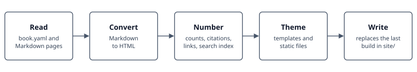

# guidebook

guidebook turns a directory of Markdown chapters into a textbook-style static site,
with numbered parts, chapters, sections, equations, figures, tables and boxed
environments, citations, client-side search, and light and dark colour schemes. The
theme comes with the package, so a book holds only its content and one configuration
file.



| Step | What it does |
|---|---|
| Read | Reads `book.yaml` and the Markdown files it lists, in reading order. |
| Convert | Turns each page's Markdown into HTML. |
| Number | Numbers sections, figures, captioned tables, boxes and equations, resolves citations and links, and collects the search index. |
| Theme | Puts each page into its template and gathers the static files. |
| Write | Replaces what the last build wrote in `site/`. |

The build stops on a broken internal link, a missing figure, a citation without a
reference entry, an `\eqref` to a label no numbered equation carries, or an equation
label used twice. A failed build leaves `site/` as it was.

## Install

```bash
pip install guidebook
```

guidebook needs Python 3.10 or later and runs on Linux, macOS and Windows.

## Usage

A book is a project directory:

```text
my-book/
├── book.yaml             # title, author, parts and chapters
├── book/
│   ├── index.md          # the title page
│   ├── help.md           # an optional help page
│   └── methods/          # a part
│       ├── index.md      # the part's opener
│       ├── basics.md     # a chapter on one page
│       └── figures/
└── theme/                # optional overrides
```

Build it and preview the result:

```bash
guidebook build my-book
python -m http.server --directory my-book/site 8000
```

Then open <http://127.0.0.1:8000/>.

```text
guidebook build [PROJECT_DIR] [--site-dir DIR] [--allow-warnings]
```

| Argument | Meaning |
|---|---|
| `PROJECT_DIR` | The directory holding `book.yaml`, by default the current one. |
| `--site-dir DIR` | Where to write the site, by default `site/` in the project directory. |
| `--allow-warnings` | Do not fail the build on warnings. A reference that is never cited is a warning. |

`python -m guidebook` runs the same command. Each build lists any files under `theme/`
that are in force.

## Writing a book

### Pages

Every page starts with a YAML front matter block.

| Key | Meaning |
|---|---|
| `title` | The page's title. Required. |
| `summary` | One sentence, shown under the title and in the contents. |
| `status` | For example `in-preparation`, which puts a badge in the contents and a notice on the page. |
| `references` | Citation keys mapped to formatted entries, which may use Markdown. |

Use `##` for sections and `###` for subsections; the build numbers them. An `##` named
"References" or "Further reading", or carrying `{: .unnumbered }`, stays unnumbered.
Section anchors come from the heading text, so renaming a heading changes its link.
`{: #my-id }` after a heading pins its anchor.

### Parts and chapters

`book.yaml` lists the parts and their chapters in reading order. Parts take Roman
numerals, and chapters are numbered continuously through the book.

```yaml
parts:
  - dir: methods
    title: Methods
    chapters:
      - basics.md
      - dir: inference
        sections:
          - likelihoods.md
          - hypothesis-tests.md
```

`dir` is the part's directory under `book/`, which needs an `index.md`. A chapter is
one Markdown file, or a `dir` with an `index.md` opener and one Markdown file per
section. Each section page is numbered within the chapter (2.1, 2.2) and its `##`
headings become subsections (2.1.1). Figures, tables, numbered boxes and equations keep
one running count through a chapter, so splitting a chapter changes none of those
numbers. Each page has its own `references` and reference list.

### Figures and tables

`` on a line of its own becomes a numbered figure. A local
SVG is copied into the page, so it can use the theme's colours and follow the colour
scheme. A table followed by a paragraph starting `Table:` becomes a numbered table, and
a table with no caption takes no number. A button on each figure and table opens it
enlarged.

### Equations

Write inline math as `$…$` and display math as `$$ … $$` on lines of their own. Every
display equation is numbered, and `\notag` suppresses a number. `\label{eq:name}` and
`\eqref{eq:name}` reach any page in the book, so a label must be unique across it.
Place `\label` after `\end{aligned}` or `\end{split}`, because MathJax discards one
written inside them.

### Citations

`[@key]` cites an entry of the page's `references`, and `[@a; @b]` cites several. The
reference list is generated at the end of the page, in order of first citation.

### Boxes

`!!! kind "Title"` sets material apart, and `??? kind "Title"` makes it collapsible.

| Kind | Effect |
|---|---|
| `definition`, `example`, `remark`, `recipe` | Numbered within the chapter, with a permalink. |
| `warning`, `caution`, `note`, `tip` | Labelled, with no number. |
| Any other, such as `summary` | Styled by its own name, with its title as written. |

### Glossary

A `\glossary` tag adds a reference to the book's glossary, which follows the last part
with an opener, a page for terms and a page for equations. The tag prints nothing, as
LaTeX's `\index` does. Each entry is a name that links to the place it marks, in
alphabetical order. A page appears once it has an entry, so a book with no tags has no
glossary.

| Where | Tag | Entry |
|---|---|---|
| A paragraph or list item | `\glossary{Name}` | A term that links to this place. |
| The start of a box | `\glossary` | A term named after the box's title, linking to the box. `\glossary{Name}` gives it another name. |
| A display equation | `\glossary{Name}` | An equation of that name. It needs a `\label` and a number. |

```markdown
!!! definition "Jet"
    \glossary
    A collimated spray of hadrons.

$$
\sigma = \int f(x) \, \hat\sigma(x) \label{eq:xsec} \glossary{Factorisation formula}
$$
```

The build stops on a name used twice on a page, and on a named equation with no label or
number.

### Help page

A book can keep what a reader needs only now and then on a page of its own, such as its
conventions, its notation, how to cite it and where to report a problem. `help_page` in
`book.yaml` names a Markdown file in `book/`, and the foot of the sidebar links to it
from every page, under the page's title. The page takes its address from the file's
name, so `help.md` is served at `help/`, and the build stops if a part or the glossary
holds that address. The page has no number, stays out of the contents and of the
previous and next links, and is covered by the search.

## Exporting

Every table, figure, code block and display equation has a button that opens a menu of
file formats. It appears when the cursor is over that component. On a touch screen it
stays faintly visible, except on a code block, where a tap shows it. It sits at the end
of a caption, at the top right of a code block or a table without a caption, and at the
left of an equation. A code block also has a button that copies its source in one click.

| Component | Formats |
|---|---|
| Table | Markdown, CSV, LaTeX, PNG, PDF |
| SVG figure | SVG, PNG, PDF |
| Other figure | PNG, PDF |
| Code block | PNG, PDF |
| Display equation | LaTeX, PNG, PDF |

Exports use the light colour scheme on a white background. Markdown and LaTeX keep a
table's caption, and images and PDFs leave it out. Every format except PDF can also be
copied to the clipboard. LaTeX output defines the book's macros it uses, and states the
packages it needs.

PDF opens the browser's print dialog with the page sized to the component, which keeps
vectors and fonts: choose "Save as PDF" there. A browser that ignores the page size
prints on its default paper.

## Configuration

`book.yaml` takes the keys below, and an unknown key stops the build.

| Key | Default | Meaning |
|---|---|---|
| `title`, `author` | required | The book's title and author. |
| `subtitle`, `kicker` | empty | The lines around the title on the home page. |
| `url` | empty | The published address. |
| `repo` | empty | The source repository, linked from the sidebar. |
| `repo_host` | empty | The name in that link, such as `GitHub`. Required with `repo`. |
| `edit_url` | empty | The prefix of a page's edit link, followed by its path under `book/`. No link appears when it is empty. |
| `help_page` | empty | The Markdown file in `book/` [linked from the foot of the sidebar](#help-page). |
| `parts` | empty | The parts and chapters, as above. |
| `enlarge_tables` | `true` | Whether a table has a button that opens it enlarged. Figures always do. |
| `export_menus` | `true` | Whether tables, figures, code blocks and equations offer an [export menu](#exporting). |
| `glossary` | `true` | Whether `\glossary` tags make [glossary](#glossary) pages. |
| `mathjax_macros` | empty | TeX macros, each a definition or `[definition, argument count]`. |
| `pygments_light`, `pygments_dark` | `friendly`, `github-dark` | The [code colours](https://pygments.org/styles/) of each colour scheme. |

```yaml
title: A Book of Methods
author: A. Author
repo: https://github.com/example/methods
repo_host: GitHub
edit_url: https://github.com/example/methods/blob/main/book/
mathjax_macros:
  dd: \mathrm{d}
  vec: ['\boldsymbol{#1}', 1]
```

## Overriding the theme

A book changes the theme through its own `theme/` directory, which the build reads
first.

| Path | Effect |
|---|---|
| `theme/templates/NAME.html` | Replaces the package's template of that name. The templates are `base`, `home`, `part`, `chapter`, `section`, `glossary` and `help`. |
| `theme/static/NAME` | Replaces the package's static file of that name, or adds a new one. A `pygments.css` here takes the place of the generated one. |

A template replaced whole no longer receives changes from new releases, so extend the
package's copy instead where a small change is enough. The package's templates stay
reachable under `guidebook/`, and `base.html` has an empty `extra_head` block for
additions to the page's head:

```jinja


<link rel="stylesheet" href="{{ page.root }}static/local.css">

```

## The site directory

The build keeps a list of its top-level entries in `site/.guidebook-stamp.json`. A
rebuild removes those entries whole and leaves any other top-level file alone. It stops
if the directory is not empty and has no stamp, as it would for a mistyped `--site-dir`
or a `site/` written by another program, and it refuses a filesystem root, the home
directory, the project directory and anything holding them.

## Revision dates

The title page and footer show when the book was revised, by default the month of the
build. A scheduled rebuild would advance that date with nothing changed, so set
[`SOURCE_DATE_EPOCH`](https://reproducible-builds.org/specs/source-date-epoch/) to the
last commit's time:

```bash
SOURCE_DATE_EPOCH=$(git log -1 --format=%ct) guidebook build
```

## License

[MIT](LICENSE)
